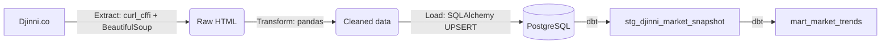

# Djinni IT Market Analytics — ETL & dbt Pipeline

An end-to-end data engineering pipeline that extracts daily job market analytics from [Djinni](https://djinni.co/) (the largest Ukrainian IT job board), loads it into PostgreSQL, and transforms it into analytical data marts with **dbt**.

The pipeline collects **aggregated** public market metrics (open positions, active candidates, salary ranges, the Djinni Index) across tech categories, experience levels and work formats. Running it daily builds a historical time series that the website itself does not provide.

## Architecture & Data Flow



## Key Engineering Decisions

- **Browser-like HTTP client:** the standard `requests` library gets blocked by Djinni's bot protection, so extraction uses `curl_cffi` to send requests with a real Chrome TLS fingerprint. Requests are rate-limited and only aggregated public data is collected.
- **Idempotent loads:** the load step uses `INSERT ... ON CONFLICT` (UPSERT) keyed on the snapshot grain (`snapshot_date`, `category`, `experience_years`, `work_format`). The pipeline can be re-run on any schedule without creating duplicates.
- **Time series without `LAG()`:** 7-day dynamics in the mart are computed with exact-date self-joins (`snapshot_date - INTERVAL '7 days'`) instead of window functions. If the scraper misses a day, `LAG()` would silently compare the wrong dates; a self-join returns `NULL` instead.
- **Data quality:** dbt tests (`not_null`, `accepted_values` and custom composite-key uniqueness tests) guard the integrity of the marts.
- **Secrets out of code:** database credentials are read from environment variables via `python-dotenv`.

## Tech Stack

| Layer | Tools |
|---|---|
| Language | Python 3.10+ |
| Extraction | `curl_cffi`, `BeautifulSoup4` |
| Transformation & loading | `pandas`, `SQLAlchemy` |
| Database | PostgreSQL |
| Data modeling & tests | dbt (`dbt-postgres`) |
| Configuration | `python-dotenv` |

## How to Run Locally

### 1. Prerequisites

- Python 3.10+
- A running PostgreSQL instance (local or remote) with an empty database

### 2. Setup

```bash
git clone https://github.com/WolandEmort/djinni-market-etl.git
cd djinni-market-etl
python -m venv .venv

# Windows
.venv\Scripts\activate
# macOS / Linux
source .venv/bin/activate

pip install -r requirements.txt
```

### 3. Environment variables

Create a `.env` file in the project root (use `.env.example` as a template):

```ini
DB_USER=postgres
DB_PASSWORD=your_password
DB_HOST=localhost
DB_PORT=5432
DB_NAME=djinni_db
```

### 4. Run the ETL

Extract the data and load the raw snapshot into Postgres:

```bash
python main.py
```

### 5. Configure dbt

dbt reads connection settings from a profile named `dbt_djinni` in `~/.dbt/profiles.yml` (this file is not stored in the repo):

```yaml
dbt_djinni:
  target: dev
  outputs:
    dev:
      type: postgres
      host: localhost
      port: 5432
      user: postgres
      password: your_password
      dbname: djinni_db
      schema: analytics
      threads: 4
```

### 6. Build the marts and run the tests

```bash
cd dbt_djinni
dbt run
dbt test
```

## Analytics Output (`mart_market_trends`)

The final mart provides these metrics out of the box:

| Metric | Description |
|---|---|
| `candidates_per_job` | Competition index: how many candidates there are per open position |
| `salary_expectation_gap` | Difference between candidate salary expectations and what companies offer |
| `candidates_change_7d` | Change in the number of candidates over the last 7 days |
| `jobs_change_7d` | Change in the number of open positions over the last 7 days |

## Notes

- The pipeline is intended for personal and educational use. It collects only aggregated public statistics, not personal data. Check Djinni's terms of use before running it at scale.
- History accumulates only while the pipeline runs on a schedule (e.g. daily via Task Scheduler or cron).